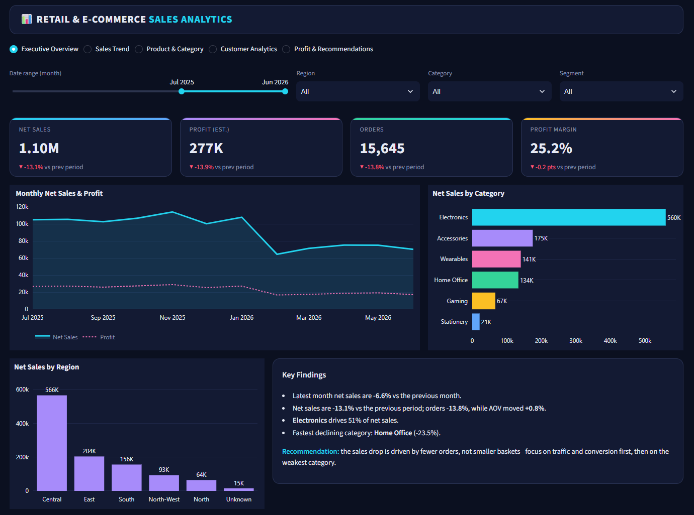
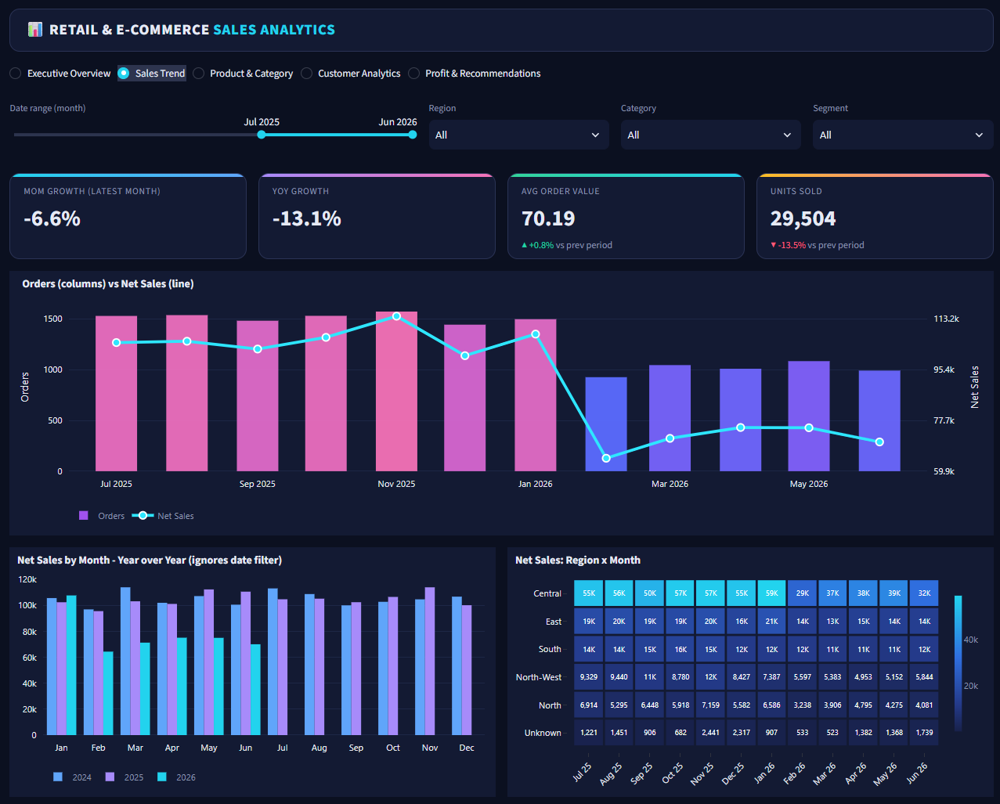
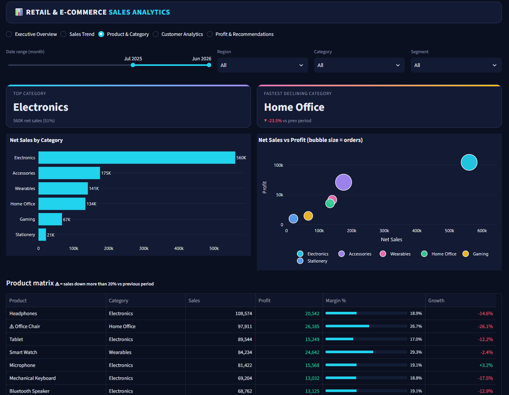
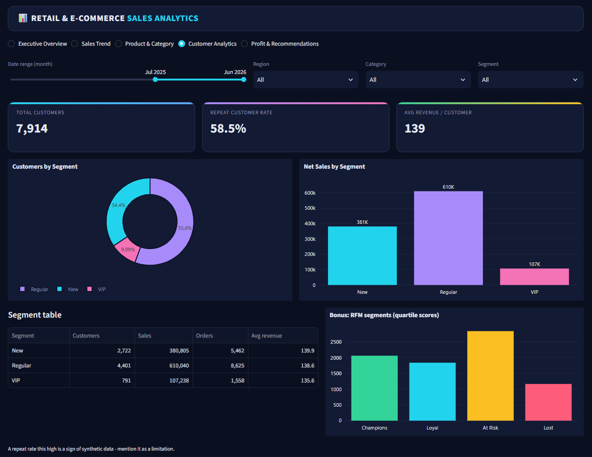
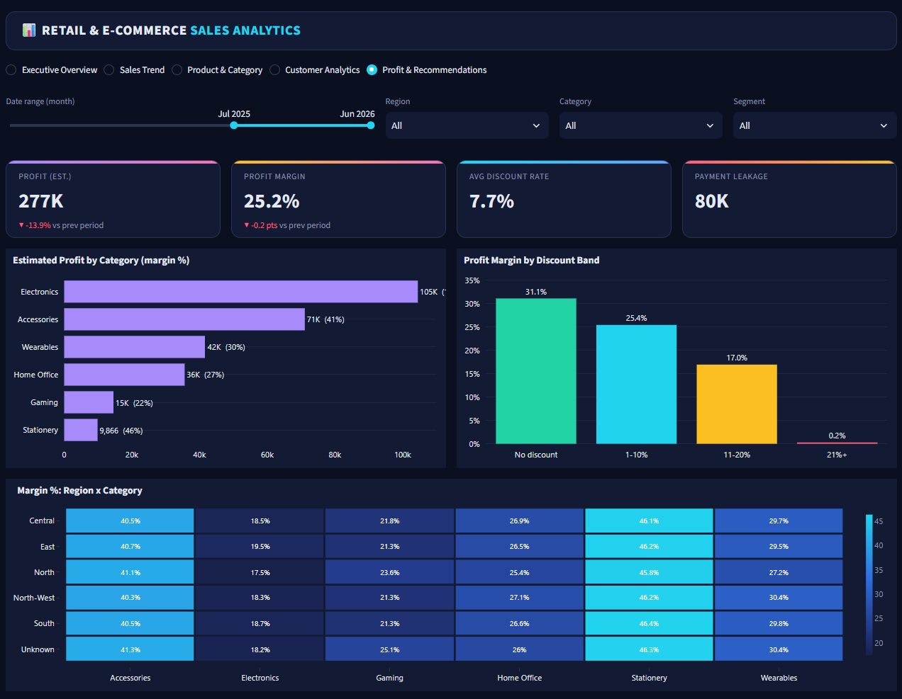

# 🛒 Retail & E-commerce Sales, Customer & Product Analytics
**Python (pandas) · SQL (PostgreSQL) · Streamlit · Plotly** — an end-to-end analytics project built for Data Analyst / BI Analyst portfolios.

<!-- Dashboard screenshots go in /images (one per page) and can be shown here. -->

## 🔴 Live Demo

**👉 [Open the interactive dashboard](https://retail-sales-analytics-9hmxelrt8quhekpdjudupp.streamlit.app/)** (Streamlit Community Cloud)

5 pages — Executive Overview · Sales Trend · Product & Category · Customer Analytics · Profit & Recommendations — with filters for date range, region, category and customer segment. > ⏱️ **Free hosting note:** the app runs on Streamlit Community Cloud's free tier, which puts idle apps to sleep. If you see a "gone to sleep" screen, click **"Yes, get this app back up!"** and wait about 30 seconds. A scheduled GitHub Action (`.github/workflows/keep-alive.yml`) visits the app every 6 hours to keep it awake.

**Run it locally:**
```bash
cd python_dashboard
pip install -r requirements.txt
streamlit run app.py
```

## 📸 Dashboard Screenshots

**1. Executive Overview** — headline KPIs, monthly trend, category and region split, key findings


**2. Sales Trend** — MoM / YoY growth, orders vs net sales, year-over-year months, region × month heatmap


**3. Product & Category** — top and fastest-declining category, sales vs profit bubbles, product matrix


**4. Customer Analytics** — customer segments, repeat rate, revenue per customer, RFM


**5. Profit & Recommendations** — profit and margin, discount impact, margin heatmap, recommendations


## 1. Project objective
Answer five business questions for a retail e-commerce business:
1. How is the business performing? 2. Are sales growing or falling? 3. Which products/categories win or lose? 4. Which customers are most valuable? 5. Where can profit be increased?

## 2. Dataset
49,830 clean order lines (Jan 2024 – Jun 2026), 10,000 customers, 20 products, 6 categories, 10 cities. Files: `orders`, `customers`, `payments`, `products`.

## 3. Methodology
| Step | Tool | Output |
|---|---|---|
| Data audit & cleaning | Excel / Python (`scripts/01_clean_data.py`) | `data/*.csv`, `docs/data_quality_report.md` |
| Star schema | fact_orders + dim_customer, dim_product, dim_date | `data/` |
| Business queries | SQL (`sql/02_schema_and_queries.sql`) | 12 queries, tested |
| Validation | `scripts/03_validate.py` | hand-check + pandas + SQL agree |
| Dashboard | Python, Streamlit, Plotly (`python_dashboard/`) | 5-page interactive dashboard with filters, deployed on Streamlit Community Cloud |

**Data quality fixes:** 120 duplicate orders removed · 35 missing dates · 80 missing + 25 negative/zero quantities removed · 220 missing discounts → 0 · 449 missing payment methods → "Unknown" · city spelling fixed (`tehran`, `Mashad`) · 30 orders with unknown customers removed.

**Net Sales definition:** Quantity × UnitPrice × (1 − Discount) for orders that are **Completed AND Paid**. Cancelled, returned, failed or refunded payments are excluded.

## 4. Key metrics (validated)
| Metric | Value |
|---|---|
| Net Sales | 2,988,380 |
| Estimated Profit* | 758,110 (25.4% margin) |
| Valid Orders | 42,696 |
| Average Order Value | 69.99 |
| Customers / Repeat rate | 9,858 / 94.4% |
| Sales leakage (cancel, return, failed payment) | 14.4% of potential sales |

## 5. Key findings
1. **Orders fell, order value did not.** Feb–Jun 2026 valid orders are **33% lower** than Feb–Jun 2025 (7,553 → 5,055) while AOV stayed flat (69.3 → 70.5). Every region declined (North-West −41%, North −38%, Central −34%, South −30%, East −24%). This is a traffic / acquisition problem, not a pricing problem.
2. **Electronics = 51% of sales but the lowest margin (18.8%)*.** Accessories (40.5%) and Stationery (46.1%) earn far more per unit sold.
3. **Deep discounts erase profit.** Margin falls from 31% (no discount) to **1%** at 30% discount; Electronics at 30% discount is loss-making*. 1,675 orders were sold at 30% off.
4. **14.4% of potential sales leak**: 1,751 *completed* orders have a **failed** payment (≈118K) and 1,392 were refunded (≈101K) — a payment-gateway / reconciliation issue.

## 6. Recommendations
| # | Recommendation | Supporting metric |
|---|---|---|
| 1 | Investigate the traffic/acquisition drop since Feb 2026; run win-back campaigns in North-West & North | Orders −33%, AOV flat |
| 2 | Cap discount at 15–20% (esp. Electronics); review 30% promotions | Margin 31% → 1% as discount rises to 30% |
| 3 | Audit payment failures on "Completed" orders and fix gateway reconciliation | 1,751 orders / ≈118K at risk |

## 7. Limitations (please read)
* \***No cost column in the dataset.** Profit uses *assumed* cost ratios per category (Accessories 55%, Electronics 75%, Wearables 65%, Home Office 68%, Stationery 50%, Gaming 72%). Profit and margin findings are illustrative; replace `CostRatio` with real cost data when available.
* **Region is derived** by grouping the 10 cities (dataset has City only). 119 customers have unknown city.
* **Repeat rate is 94%** because every customer has ~5 orders — it does not separate customers well. Segments New / Regular / VIP show nearly identical spend per customer, so the provided segment labels add little insight (RFM is more useful).
* **SignupDate is after the first order for 5,092 customers** → data looks synthetic; SignupDate is not used in KPIs.
* 2026 is a partial year (Jan–Jun); use YTD comparisons.
* Data appears synthetic and the currency is not specified.

## 8. How to run
```bash
python scripts/01_clean_data.py     # builds /data (run from the repo root)
python scripts/03_validate.py       # prints validation checks
# load /data into PostgreSQL, run sql/02_schema_and_queries.sql
cd python_dashboard && pip install -r requirements.txt && streamlit run app.py
```

## 9. Other portfolio projects
- [SEO Growth Agent (n8n)](https://github.com/sakter2618-maker/n8n-seo-growth-agent): a scheduled automation that audits a website's SEO, saves results to Google Sheets, emails a weekly report and proposes fixes as pull requests.
- [Sutokotha demo store](https://github.com/sakter2618-maker/sutokotha): the test website the agent audits ([live site](https://sakter2618-maker.github.io/sutokotha/)).
